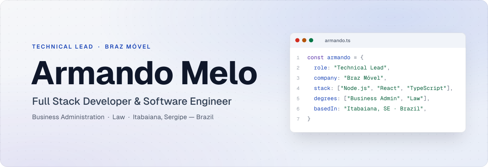
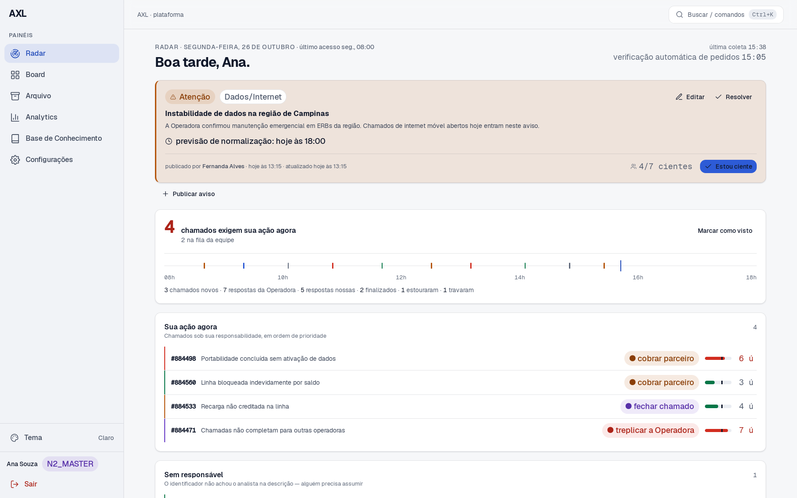

<picture>
  <source media="(prefers-color-scheme: dark)" srcset="assets/banner-dark.svg">
  
</picture>

  
  
  

 

## Hi, I'm Armando 👋

I lead the technical team at **Braz Móvel**, a mobile virtual network operator (MVNO) running on Vivo's network in Brazil. Day to day, that means keeping carrier incidents within SLA, supporting the internet providers that resell our lines, and building the software that makes all of it measurable.

My path is not the usual one. I hold bachelor's degrees in **Business Administration** and **Law**, and trained as a **Full Stack Developer** and **Software Engineer** at Alura. That mix shapes how I build: I read an SLA like a contract, a process like a cost, and a feature like something a team will live with every day.

## What I do

- **Lead the technical team** at Braz Móvel — incident escalation with the carrier, partner support and the tooling behind both.
- **Build internal platforms end to end** — Node.js and Express back ends, React and TypeScript front ends, deployed and operated on Linux.
- **Integrate the systems an operator runs on** — carrier portal APIs, the Opa Suite support platform and the ERPs our partner providers use.
- **Put AI to work where it earns its place** — generated text goes through deterministic validation before it reaches a carrier or a partner.

## Featured project

### [AXL](https://github.com/Mrpapaco1/AXL) — SLA audit & NOC operations platform

Running in production at the NOC where I work. The [public version](https://github.com/Mrpapaco1/AXL) replaces every company and personal detail with fictional data · ▶ **[Live demo](https://mrpapaco1.github.io/AXL/)**

<a href="https://mrpapaco1.github.io/AXL/">
  <picture>
    <source media="(prefers-color-scheme: dark)" srcset="assets/axl-radar-dark.png">
    
  </picture>
</a>

AXL audits every carrier incident Braz Móvel opens against a five-business-day SLA, flags the ones that stop moving, and drafts the follow-up an analyst would write. It also turns support chats into team productivity metrics and gives each partner provider a window into its own tickets.

- **SLA radar** — a live queue ordered by deadline, with business-day countdowns and automatic detection of tickets that stopped moving.
- **AI-drafted follow-ups** — written in the analyst's voice, one specific question per case, always reviewed by a person before sending.
- **Team analytics** — first-contact resolution, recurrence and top offenders from support chats, plus a monthly executive report.
- **Automated portability re-checks** against the carrier API, with per-run caps and a kill switch.
- **Partner portal** — strict per-partner data isolation, append-only audit trail, rate limiting and signed links.
- **Knowledge base** — step-by-step integration guides for the partner ERPs (IXC, Hubsoft, SGP and Atlaz).

<table>
  <tr>
    <td align="center" width="25%"><h3>700+</h3>automated tests guarding the business rules</td>
    <td align="center" width="25%"><h3>9</h3>color themes, contrast-checked against WCAG</td>
    <td align="center" width="25%"><h3>5</h3>runtime dependencies on the back end</td>
    <td align="center" width="25%"><h3>6</h3>background routines, each with its own lock</td>
  </tr>
</table>

`Node.js 24` `Express 5` `React 19` `TypeScript` `Vite` `Tailwind CSS` `TanStack Query` `Vitest` `Linux` `systemd`

## Tech stack

<table>
  <tr>
    <td><b>Languages</b></td>
    <td>
      
      
    </td>
  </tr>
  <tr>
    <td><b>Back end</b></td>
    <td>
      
      
      
    </td>
  </tr>
  <tr>
    <td><b>Front end</b></td>
    <td>
      
      
      
      
    </td>
  </tr>
  <tr>
    <td><b>Testing</b></td>
    <td>
      
      
    </td>
  </tr>
  <tr>
    <td><b>Operations</b></td>
    <td>
      
      
      
      
    </td>
  </tr>
  <tr>
    <td><b>AI</b></td>
    <td>
      
      
    </td>
  </tr>
</table>

## Education

<table>
  <tr><td>💻 <b>Full Stack Developer</b></td><td>Alura</td></tr>
  <tr><td>🧩 <b>Software Engineer</b></td><td>Alura</td></tr>
  <tr><td>⚖️ <b>Law</b></td><td>Bachelor of Laws (LL.B.)</td></tr>
  <tr><td>📊 <b>Business Administration</b></td><td>Bachelor's degree</td></tr>
</table>

## How I build

- **Decisions live next to the code.** Every module opens by saying what problem it solves and why it exists.
- **Business rules are tested, not trusted.** If a rule decides what an analyst sees, it has a test.
- **Every external side effect has an off switch.** Turning a routine off should never require a deploy.
- **Real customer data never leaves production.** Demos, screenshots and fixtures use invented data.

## Let's talk

📫 [josearmando10067@gmail.com](mailto:josearmando10067@gmail.com) &nbsp;·&nbsp; 📍 Itabaiana, Sergipe — Brazil (UTC−3)
